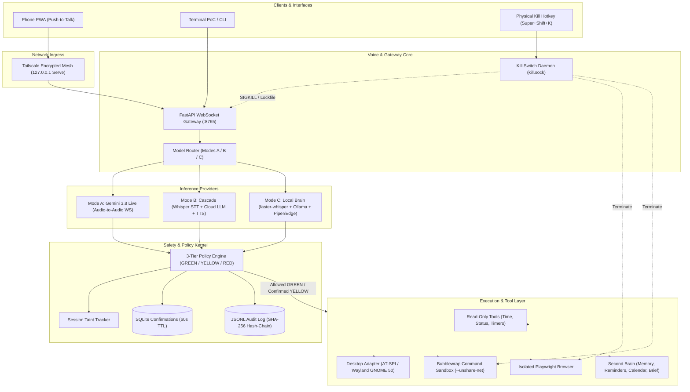

# Cyber Agent — System Architecture (v1.0.0)

Cyber Agent is a personal, voice-first, bilingual (Uzbek-focused) autonomous AI assistant engineered for owner Azimjon on Ubuntu 26.04 (Linux x86_64, RTX 5070 Laptop GPU, AMD Ryzen 9 9955HX).

---

## 1. Architectural Principles & Security Invariants

Cyber Agent is designed around defense-in-depth and the principle of least privilege:

1. **Localhost Binding Only:** Every server socket (`gateway`, `kill-switch`, `mcp`) binds strictly to `127.0.0.1` or a private Unix domain socket (`/run/user/1000/cyber-agent/kill.sock`). Public bindings (`0.0.0.0`) are hard-blocked by unit tests and automated doctor audits.
2. **Strict Tailscale Private VPN:** Remote access from the owner's phone PWA uses encrypted Tailscale mesh (`tsnet`/Tailscale Serve). Tailscale Funnel and public port-forwarding are forbidden.
3. **Tri-Tier Security Policy Engine:** All operations are classified into `GREEN`, `YELLOW`, or `RED`. Destructive operations (arbitrary shell, deleting files, reading secret keys, payment, `sudo`) do not exist and are hard-blocked.
4. **Session Taint Tracking:** Any ingested external untrusted data (web pages, calendar event descriptions, emails, external files) instantly marks the active conversation context as `TAINTED`. Tainted sessions cannot execute `YELLOW` actions without explicit re-confirmation with warning cards.
5. **Hardware Kill Switch:** A standalone, non-interceptible daemon runs independently of the LLM/Agent process. Triggering the kill switch (via hotkey or socket) immediately halts all agent processes, terminates active browsers, and drops a lockfile.
6. **Privacy Mode & Local Fallback:** Engaging Privacy Mode severs all outbound cloud connections and locks execution to Mode C (Local Whisper + Ollama + Local TTS), producing zero network packets.

---

## 2. High-Level Component Topology

---

## 3. Core Subsystems

### 3.1. Voice Gateway & Tri-Mode Router

The gateway provides real-time streaming audio I/O using standard WebSockets. Audio frames (16 kHz, 16-bit PCM, mono) stream bi-directionally with client-side Push-to-Talk and barge-in interruption.

- **Mode A (Gemini 3.8 Live API):**
  Direct streaming audio-to-audio over secure WebSockets (`google-genai` SDK). Employs Uzbek system persona, input/output transcription streaming, context compression, and automatic resumption on network hiccups.
- **Mode B (Cloud Cascade):**
  Speech-to-Text via `faster-whisper` (or cloud STT) -> Gemini Flash LLM -> TTS audio playback. Ideal fallback when Live connection is degraded.
- **Mode C (Local Brain — 100% Offline):**
  `faster-whisper` (medium / large-v3-turbo on CUDA float16) -> Ollama (`qwen2.5:7b-instruct-q4_K_M`) -> Local TTS. Runs within the 8 GB laptop VRAM budget (measured peak ~6.25 GB).

### 3.2. Safety Kernel & Policy Engine

All actions proposed by the LLM (whether cloud or local) pass through strict Pydantic validation and the `PolicyEngine`:
- **GREEN (Auto-Execute):** Read-only actions that do not alter system or external state (`get_local_time`, `get_system_status`, `list_timers`, `read_ui_tree`, `memory_recall`, `get_calendar_events`, `translate_text`).
- **YELLOW (Confirmation Required):** Mutating actions (`gui_click`, `gui_type`, `run_sandboxed_command`, `open_allowed_app`, `create_timer`, `memory_remember`, `memory_forget`, `create_calendar_event`). Generates a single-use token with a 60-second expiry stored in SQLite. The action only executes when the client returns the valid token.
- **RED (Hard Denied):** Arbitrary shells, `sudo`, deleting files, reading credentials/tokens, payment processing, git force-pushing. Registry rejection tests guarantee these tools are never loaded.

### 3.3. Desktop Automation & Wayland Integration

Operating under Ubuntu 26.04 GNOME 50 Wayland across dual monitors (2560x1600 + 1920x1080):
- **AT-SPI Accessibility Subsystem:** Queries window hierarchies, control roles, labels, and accessible states without screen-scraping.
- **Target Verification & Password Shield:** Before dispatching clicks or keystrokes, verifies the window title matches the target application. Any element tagged with password roles (`ROLE_PASSWORD_TEXT`, `ROLE_SECRET`) is blocked at the driver level.
- **Sensitive Window Shielding:** Protects sensitive applications listed in `config/sensitive_windows.toml` (e.g. Keepass, Bitwarden, Terminal windows with sensitive prompts) from automated inspection or input.

### 3.4. Bubblewrap Sandbox (`bwrap`)

Commands permitted in `config/commands_allowlist.toml` run inside a rootless Bubblewrap container:
- Isolated network namespace (`--unshare-net`) prevents unauthorized network access.
- Read-only root filesystem (`--ro-bind / /`) with ephemeral `tmpfs` mounts for `/tmp`.
- Restricted access to user home directory (`--bind ~/Cyber_Agent ~/Cyber_Agent`).
- Hard limits on execution time (default 10s timeout) and output buffers (capped at 64 KB).

### 3.5. Second Brain & Productivity Subsystems

1. **Memory Engine:** SQLite database backed by FTS5 full-text indexing. Filter filters out sensitive information (API keys, passwords, bank cards, national IDs) using strict regular expressions and checks.
2. **Persistent Reminders:** Background cron scheduler operating strictly in the `Asia/Tashkent` timezone. Reminders survive daemon restarts and trigger desktop alerts via `notify-send`.
3. **Morning Brief:** Aggregates current weather, daily reminders, and upcoming Google Calendar events into an executive Uzbek briefing.
4. **Google Calendar:** OAuth2 integration restricted to read-only scopes by default. Untrusted event content marks the session as tainted.
5. **Translation Mode:** Direct bilingual bridge (Uzbek, Russian, English) that strictly preserves IT terms (`API`, `Git`, `Docker`, `Pytest`, `Linux`) and proper nouns.

---

## 4. Disaster Recovery & Emergency Controls

- **Kill Switch:** Monitored on `/run/user/1000/cyber-agent/kill.sock`. Receives shutdown pulses or hardware key combos (`Super+Shift+K`), instantly killing agent processes and locking the gateway socket.
- **Automated Backup & Restore:** `scripts/backup.py` creates SHA-256 verified encrypted tarballs of all SQLite databases, configuration files, and audit logs. `scripts/restore_drill.py` verifies data integrity with zero path traversal vulnerabilities.
- **Diagnostics:** `scripts/doctor.py` provides 7-point pre-flight validation covering sockets, Tailscale VPN status, kill switch responsiveness, and cryptographic audit log continuity.
